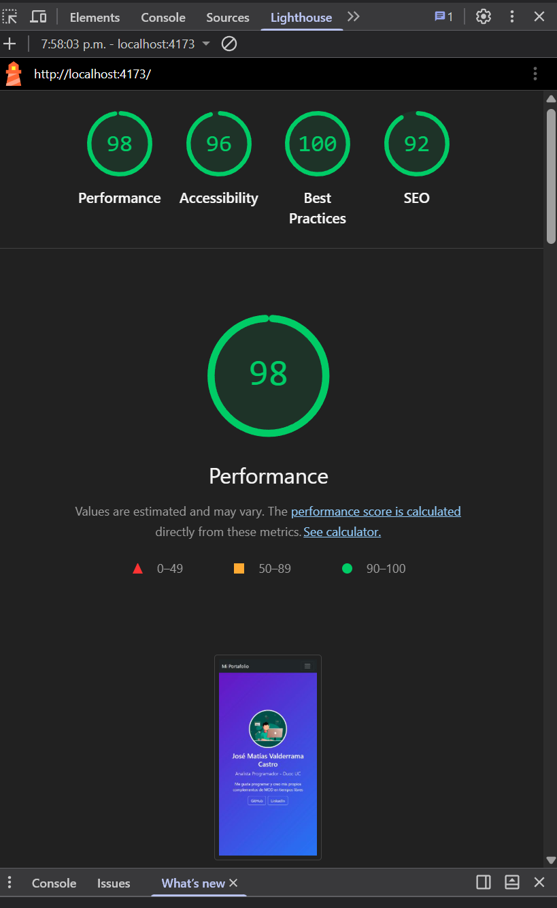
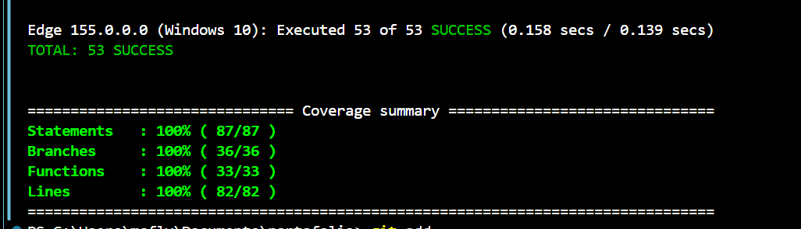

# Portafolio Personal

Portafolio personal desarrollado con **React** y **Bootstrap**, con datos cargados desde archivos **JSON** y pruebas unitarias con **Jasmine** y **Karma**.

Proyecto de la Evaluación Formativa N°2 de **DSY1104 – Desarrollo Fullstack II**, Duoc UC.

🔗 **Sitio publicado:** https://test-debug10.github.io/portafolio/


---

## Contenido

- [Tecnologías](#tecnologías)
- [Características](#características)
- [Capturas](#capturas)
- [Requisitos](#requisitos)
- [Instalación](#instalación)
- [Ejecución](#ejecución)
- [Pruebas](#pruebas)
- [Publicación](#publicación)
- [Ejemplos de uso: editar el contenido](#ejemplos-de-uso-editar-el-contenido)
- [Estructura del proyecto](#estructura-del-proyecto)
- [Componentes](#componentes)
- [Accesibilidad y rendimiento](#accesibilidad-y-rendimiento)
- [Documentación adicional](#documentación-adicional)

---

## Tecnologías

| Área | Herramientas |
|---|---|
| Interfaz | React, Vite |
| Diseño | Bootstrap 5, React-Bootstrap |
| Datos | Archivos JSON cargados con `fetch` |
| Pruebas | Jasmine, Karma, Testing Library |
| Cobertura | karma-coverage, babel-plugin-istanbul |
| Publicación | GitHub Pages, gh-pages |

## Características

- **Introducción** con nombre, foto, biografía y enlaces a redes sociales.
- **Proyectos** en tarjetas de Bootstrap, con imagen, descripción, tecnologías y enlace, más un **filtro por tecnología**.
- **Dos secciones de noticias** (Tecnología y Mis novedades) cargadas desde JSON, ordenadas por fecha y con botón **Ver más / Ver menos**.
- **Formulario de contacto** con validación de campos y mensajes de error.
- **Diseño responsivo** con el sistema de grilla de Bootstrap: se adapta a celular, tablet y escritorio.
- **53 pruebas unitarias** con **100 % de cobertura**, ejecutadas en Chrome/Edge y Firefox.

## Capturas

| Celular | Lighthouse |
|---|---|
|  |  |

| Pruebas | Cobertura |
|---|---|
|  |  |

---

## Requisitos

- [Node.js](https://nodejs.org) versión 20 o superior (incluye npm)
- [Git](https://git-scm.com)
- Para las pruebas: Google Chrome o Microsoft Edge. Firefox es opcional, para probar en varios navegadores.

## Instalación

1. Clonar el repositorio:

```bash
git clone https://github.com/Test-debug10/portafolio.git
```

2. Entrar a la carpeta:

```bash
cd portafolio
```

3. Instalar las dependencias:

```bash
npm install
```

## Ejecución

| Comando | Descripción |
|---|---|
| `npm run dev` | Inicia el servidor de desarrollo en http://localhost:5173/portafolio/ |
| `npm run build` | Genera la versión optimizada en la carpeta `dist` |
| `npm run preview` | Muestra la versión optimizada en http://localhost:4173/portafolio/ |

## Pruebas

| Comando | Descripción |
|---|---|
| `npm test` | Ejecuta todas las pruebas una vez y genera el informe de cobertura |
| `npm run test:watch` | Repite las pruebas automáticamente al guardar un archivo |
| `npm run test:navegadores` | Ejecuta las pruebas en Chrome/Edge y Firefox |

Resultado esperado:

```
Executed 53 of 53 SUCCESS

Statements   : 100%
Branches     : 100%
Functions    : 100%
Lines        : 100%
```

El informe detallado de cobertura se genera en `coverage/html/index.html`. Ábrelo en el navegador para ver, archivo por archivo, qué líneas fueron probadas.

Si Karma no encuentra Chrome, usa Microsoft Edge automáticamente (configurado en `karma.conf.cjs`).

### Qué se prueba

| Tipo | Ejemplos |
|---|---|
| Renderizado | Cada componente muestra los datos que recibe por props |
| Interacción con el DOM | Atributos `alt`, `href`, `datetime`, clases de Bootstrap |
| Eventos y estado | Filtro de proyectos, botón Ver más, validación y envío del formulario |
| Mocks | `fetch` simulado (éxito, error 404, carga pendiente) y función espía para el envío del formulario |
| Integración | La aplicación completa con datos simulados |

## Publicación

El sitio se publica en GitHub Pages con:

```bash
npm run deploy
```

Este comando genera la versión optimizada y la sube a la rama `gh-pages`.

---

## Ejemplos de uso: editar el contenido

Todo el contenido está en `public/data`, así que **no es necesario modificar código** para actualizar el portafolio.

### Cambiar la información personal

Editar `public/data/perfil.json`:

```json
{
  "nombre": "Tu Nombre",
  "titulo": "Estudiante de Ingeniería en Informática - Duoc UC",
  "foto": "img/perfil.webp",
  "biografia": "Breve descripción personal.",
  "github": "https://github.com/tu-usuario",
  "linkedin": "https://www.linkedin.com/in/tu-usuario"
}
```

### Agregar un proyecto

1. Copiar la imagen en `public/img` (se recomienda formato WebP y menos de 100 KB).
2. Agregar un objeto al final de `public/data/proyectos.json`:

```json
{
  "id": 4,
  "titulo": "Nuevo proyecto",
  "descripcion": "Qué hace el proyecto.",
  "imagen": "img/proyecto4.webp",
  "tecnologias": ["React", "Node"],
  "enlace": "https://github.com/tu-usuario/nuevo-proyecto"
}
```

Las tecnologías nuevas aparecen automáticamente como botones en el filtro.

### Agregar una noticia

Agregar un objeto en la lista `tecnologia` o `personales` de `public/data/noticias.json`:

```json
{
  "id": 4,
  "titulo": "Título de la noticia",
  "fecha": "2026-11-01",
  "contenido": "Resumen breve."
}
```

Las noticias se ordenan solas por fecha. Si hay más de dos, aparece el botón **Ver más**.

---

## Estructura del proyecto

```
portafolio/
├── docs/                      Plan de pruebas, informe de cobertura y capturas
├── public/
│   ├── data/                  Archivos JSON con el contenido
│   └── img/                   Foto de perfil e imágenes de proyectos
├── src/
│   ├── components/            Componentes React
│   ├── services/
│   │   └── dataService.js     Funciones que cargan los JSON
│   ├── utils/
│   │   ├── formato.js         Formato y orden de fechas
│   │   └── validacion.js      Validación del formulario
│   ├── App.jsx                Componente principal: carga los datos y arma la página
│   └── main.jsx               Punto de entrada
├── test/                      Pruebas (misma estructura que src)
├── karma.conf.cjs             Configuración de Karma y cobertura
└── vite.config.js             Configuración de Vite
```

## Componentes

| Componente | Props | Estado | Descripción |
|---|---|---|---|
| `BarraNavegacion` | `marca`, `enlaces` | — | Navbar de Bootstrap; se colapsa en celulares |
| `Intro` | `nombre`, `titulo`, `foto`, `biografia`, `github`, `linkedin` | — | Presentación personal |
| `Proyectos` | `proyectos` | `filtro` | Lista de proyectos con filtro por tecnología |
| `ProjectCard` | `titulo`, `descripcion`, `imagen`, `tecnologias`, `enlace` | — | Card de Bootstrap para un proyecto |
| `Noticias` | `noticias` | — | Agrupa las dos secciones de noticias |
| `NewsSection` | `titulo`, `noticias`, `limite` | `mostrarTodas` | Sección de noticias reutilizable con Ver más |
| `NewsItem` | `titulo`, `fecha`, `contenido` | — | Una noticia |
| `ContactForm` | `onEnviar` | `datos`, `errores`, `enviado` | Formulario de Bootstrap con validación |
| `PiePagina` | `nombre`, `github`, `linkedin` | — | Pie de página |

Cada componente está documentado con comentarios JSDoc en su archivo.

## Accesibilidad y rendimiento

**Accesibilidad**
- Texto alternativo (`alt`) en todas las imágenes.
- Navegación completa con teclado y enlace **Saltar al contenido**.
- Etiquetas conectadas a cada campo del formulario.
- Atributos ARIA en el menú, los filtros y el botón Ver más.
- Estructura semántica (`nav`, `main`, `section`, `footer`, `time`) e idioma de la página en español.
- Se desactivan las animaciones si el sistema tiene activada la opción de reducir movimiento.

**Rendimiento**
- Imágenes en formato WebP y redimensionadas.
- Carga diferida de imágenes (`loading="lazy"`).
- Código minimizado por Vite al generar la versión final.

## Documentación adicional

- [Plan de pruebas](docs/PLAN_DE_PRUEBAS.md)
- [Informe de cobertura](docs/INFORME_COBERTURA.md)

---

**Autor:** Tu Nombre · [GitHub](https://github.com/Test-debug10)
